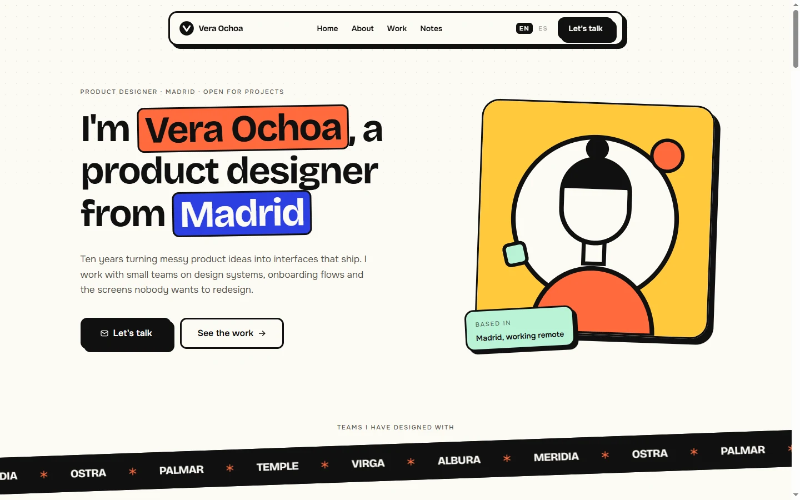

# Vera Ochoa — Product Designer Portfolio

A bilingual portfolio for a product designer: nine sections, three written notes and a design system built from scratch on top of a single acid palette.



## Overview

Vera Ochoa is a one-person portfolio site with a clear job: show the work, explain how it gets made, and make it easy to start a conversation. It is built as a static, typographic, neo-brutalist page: hard borders, offset shadows, marker highlights and geometric illustrations drawn in SVG rather than sourced from a template pack.

Everything is generated at build time in English and Spanish, including three standalone note pages, and the site ships with no third-party assets, no image files and no UI framework.

## Key Features

- **Bilingual routing (`en` / `es`)**: Typed dictionaries, `/[locale]` segments, `Accept-Language` negotiation and a `vera.locale` cookie that remembers an explicit choice.
- **Real writing, not placeholders**: Three notes with their own routes (`/[locale]/notes/[slug]`), metadata, sitemap entries and language alternates.
- **Original SVG artwork**: Portraits, service tiles, project covers and note headers are hand-built from primitives in the site palette. There is not a single raster image in `public/`.
- **A design system, not a theme file**: `@theme` tokens for colour, type scale, section rhythm and the two hard shadows, consumed through a five-component kit.
- **CSS-only motion**: The client marquee and the scroll reveal are CSS animations. The site has one client component: the mobile menu.
- **Consistent metadata**: Canonical URLs, `hreflang` alternates with `x-default`, per-locale OpenGraph tags, a multilingual sitemap and a generated 1200×630 card.
- **Localised 404**: A `[locale]/[...rest]` catch-all routes unknown paths into the styled not-found page.

## Tech Stack

- **Framework**: Next.js 16.4.3 (App Router, Turbopack)
- **Library**: React 19.3
- **Language**: TypeScript 5.7.3 (strict)
- **Styling**: Tailwind CSS 4.3.3 with CSS-first `@theme` tokens
- **Typography**: Bricolage Grotesque (display) and Onest (text), self-hosted via `next/font`
- **Analytics**: `@vercel/analytics`
- **Package Manager**: pnpm 11.17

Six runtime dependencies in total; no component library, icon pack or animation library.

## Architecture

```
vera-ochoa/
├── docs/
│   ├── provenance.md          # Compliance ledger and transformation history
│   └── screenshot.webp        # Visual preview artifact
├── src/
│   ├── app/
│   │   ├── [locale]/
│   │   │   ├── [...rest]/page.tsx      # Catch-all that renders the 404
│   │   │   ├── layout.tsx     # Locale shell, font variables, analytics
│   │   │   ├── not-found.tsx  # Styled 404
│   │   │   ├── notes/[slug]/page.tsx   # Three pre-rendered note pages
│   │   │   ├── opengraph-image.tsx     # 1200x630 social card
│   │   │   └── page.tsx       # Composed landing route
│   │   ├── globals.css        # Design tokens, utilities and keyframes
│   │   ├── icon.svg           # Brand mark
│   │   ├── robots.ts
│   │   └── sitemap.ts
│   ├── components/
│   │   ├── art/               # Portrait, service, project and note illustrations
│   │   ├── landing/           # The nine sections plus navigation and footer
│   │   ├── button.tsx
│   │   ├── icons.tsx
│   │   └── kit.tsx            # Container, Section, Label, Highlight, Heading2
│   ├── config/site.ts
│   ├── i18n/
│   │   ├── config.ts
│   │   ├── dictionaries/      # Typed English and Spanish copy
│   │   └── get-dictionary.ts
│   ├── lib/
│   │   ├── format.ts          # Locale-aware date formatting
│   │   ├── seo.ts
│   │   └── utils.ts
│   └── proxy.ts               # Locale detection and persistence
├── eslint.config.mjs
├── next.config.ts
├── package.json
└── tsconfig.json
```

## Getting Started

### Prerequisites

- Node.js >= 20.9.0
- pnpm >= 10.0.0

### Installation

```bash
git clone https://github.com/JORDANROBERTO74/vera-ochoa.git
cd vera-ochoa
pnpm install
```

### Development

```bash
pnpm dev
```

Visit [http://localhost:3000](http://localhost:3000). The root redirects to `/en` or `/es` based on the request.

### Quality Checks

```bash
pnpm typecheck   # TypeScript, no emit
pnpm lint        # ESLint flat config
pnpm build       # Production build
```

## Deployment

The site is deployed on Vercel with the default Next.js preset. Import the repository, or run:

```bash
vercel deploy --prod
```

Set `NEXT_PUBLIC_SITE_URL` when serving from a custom domain; otherwise the canonical URL falls back to `https://veraochoa.vercel.app`.

## Performance & SEO

- `/en`, `/es` and the six note paths are statically generated; only locale negotiation runs at the edge.
- No images: the page loads HTML, CSS, fonts and two small scripts (analytics and the mobile menu).
- Fonts are bundled at build time by `next/font` with automatic size-adjust metrics, so there is no layout shift and no request to a font CDN.
- `sitemap.xml` includes the landing page and every note in both languages, with `hreflang` alternates.
- Note pages ship their own title, description, canonical URL and OpenGraph tags.

## Accessibility

- Semantic landmarks, one `h1` per page and a logical heading order.
- Skip link, visible focus rings and a mobile menu that closes on `Escape`, locks background scroll and exposes `aria-expanded`/`aria-controls`.
- Decorative illustrations and marquee duplicates are marked `aria-hidden`.
- Motion is disabled under `prefers-reduced-motion`.
- Colour pairs (ink on paper, ink on coral, paper on ink, paper on cobalt) meet WCAG AA.

## Compliance & Licensing

This project was rebuilt under clean-room principles:

- No third-party trademarks, real people, quotes or contact details.
- The client names, testimonies, metrics and personae are fictional.
- Every illustration and brand mark is original and lives in the repository.
- The full audit trail lives in [`docs/provenance.md`](docs/provenance.md).

## License

Proprietary, all rights reserved. See [LICENSE](LICENSE) for details.
